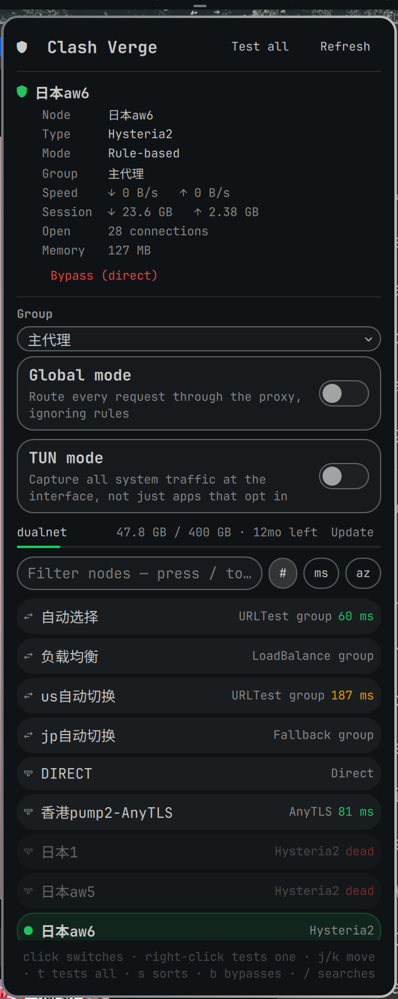

# Omarchy Clash Verge Plus

An Omarchy bar plugin for Clash Verge and standalone Mihomo cores. In addition
to node switching, latency and traffic, this fork manages multiple providers,
refreshes HTTP subscriptions automatically, predicts quota exhaustion from
local usage history, and repairs stale proxy connections after the default
network changes.



## Why this exists

[jkoestinger/omarchy-vpn](https://github.com/jkoestinger/omarchy-vpn) already
covers Proton VPN, Mullvad, Windscribe and NetworkManager beautifully, and
its bar-button/hero/target-list/filter interaction pattern is what this
plugin borrows. But Clash Verge isn't a VPN tunnel — it's a local proxy
individual apps opt into (or a TUN device, if you have that on), it doesn't
exclude a real VPN the way a tunnel does, and "connected" means "the proxy
is actively routing traffic," not "a tunnel is up." That's a different
enough model that it didn't make sense as a fifth backend bolted onto that
project's `VpnController` — see `model/Clash.js`'s header comment for the
longer version.

## What this fork adds in 2.0.0

- Reframes the panel around a unified **ChatGPT routes / Subscriptions** flow:
  every managed subscription contributes candidates to one availability scan,
  passing nodes keep their source label, and advanced Clash controls stay
  available without competing with the primary route workflow.

- Uses provider-scoped parallel health checks, so testing every subscription
  never clears the active `Fallback` pin; only verified nodes appear in the
  unified route list, sorted by latency.

- Lists every managed HTTP and File provider, including quota-free fallback
  providers, with per-provider and **Refresh all** actions.
- Allows a comma-separated provider list to select and order the subscriptions
  shown by the panel.
- Automatically refreshes all managed HTTP subscriptions on a configurable
  interval; the manual action bypasses the old two-minute display throttle.
- Stores quota-only snapshots under
  `~/.local/state/omarchy/clash-verge-plus/quota-history.json`. URLs, node
  credentials and subscription contents are never written there.
- Estimates time to exhaustion from the current monotonic quota cycle. It
  waits for at least two samples spanning 30 minutes, ignores samples before
  a quota reset, and shows confidence based on the observation span.
- Optionally watches the default route. After a network change it closes stale
  Mihomo connections, immediately health-checks each managed provider, and
  refreshes the panel.
- Adds `refreshSubscriptions` and `recoverNetwork` IPC actions for scripting.

## Features inherited from 1.1.0

- Per-node latency in the target list, taken from the probe history mihomo
  already keeps — no extra requests, no extra probing cost.
- A **Test all** button that probes every node in the group with one
  request, plus right-click on any row to test just that node.
- A group picker covering every group in your config instead of just the
  one named in settings.
- Correct handling of URLTest and Fallback groups: clicking a node sets a
  fixed pin (which is how mihomo means it to work), and an **Automatic**
  row at the top of the list unpins it again.
- A TUN toggle alongside global mode.
- Live up/down throughput with session totals and the open connection
  count.
- A subscription quota bar showing usage, expiry and a provider update
  button.
- An optional bar label showing the node name or live throughput,
  colour-coded by state.
- Keyboard navigation: `j`/`k` move, `Enter` activates, plus `t` (test
  all), `s` (cycle sort) and `b` (bypass).
- IPC verbs for Hyprland binds — see [Scripting](#scripting).
- Settings for the unix socket path, a TCP external-controller URL and the
  API secret, so a mihomo core running on its own works too.
- Real error messages derived from curl exit codes, instead of reporting
  every failure as "Clash Verge isn't running".

## How it talks to Clash Verge

Clash Verge exposes a REST API over a local unix socket
(`/tmp/verge/verge-mihomo.sock`) — no TCP port and no secret for the default
setup. A core reached over TCP instead works too, via the external-controller
URL and secret settings below. This widget:

- `GET /configs` — reads `mode` (`rule` / `global` / `direct`) and whether
  TUN is on
- `GET /proxies/<group>` — reads the active node, choices, type and fixed
  pin of the group being driven
- `GET /proxies/GLOBAL` — fallback when the configured group name isn't in
  the config
- `GET /proxies` — full proxy dump; member types label the target list,
  and the delay-probe history each entry carries is where per-node latency
  comes from
- `GET /connections` — session totals, throughput counters and the open
  connection count
- `GET /providers/proxies` — subscription quota and expiry; fetched on
  demand and throttled, because it is by far the largest document
- `GET /group/<group>/delay` — probes every node in the group with one
  request (the Test all button)
- `GET /providers/proxies/<provider>/<node>/healthcheck` — the ChatGPT
  assistant probes provider nodes independently and in parallel so scanning
  cannot clear a Fallback group's manual selection
- `GET /proxies/<node>/delay` — probes a single node (right-click on a row)
- `PUT /proxies/<group>` — switches the active node, or pins one in an
  auto-selecting group
- `DELETE /proxies/<group>` — clears that pin, handing the choice back to
  the group
- `PATCH /configs` — flips `mode` (bypass / restore / global) or TUN
- `PUT /providers/proxies/<name>` — re-fetches a subscription
- `GET /providers/proxies/<name>/healthcheck` — immediately re-tests provider
  nodes after a network change
- `DELETE /connections` — drops connections tied to the previous uplink so
  clients reconnect through the new one

Polling is tiered so the closed bar stays cheap: a closed panel fetches
about 3.5 KB per poll (`/configs` plus the active group, plus
`/connections` only when the bar shows speed), while an open one also pulls
the full proxy dump at most every 9 seconds — the rest of its polls are
light ones every 2 seconds, keeping throughput live without re-fetching a
74 KB list that barely changes.

## Requirements

- Omarchy Quattro with shell plugin support
- [Clash Verge](https://github.com/clash-verge-rev/clash-verge-rev) running,
  with its socket at the default path, or a standalone Mihomo controller URL

## Install

```bash
git clone --branch feat/subscription-intelligence \
  https://github.com/hulingjun/omarchy-clash-verge.git \
  ~/.config/omarchy/plugins/hulingjun.clash-verge-plus
omarchy plugin enable hulingjun.clash-verge-plus right
```

## Remove

```bash
omarchy plugin remove hulingjun.clash-verge-plus
```

Removal only deletes the plugin's own directory under
`~/.config/omarchy/plugins/` and its entry in `~/.config/omarchy/shell.json`.
It never touches Clash Verge itself or its configuration — the widget only
ever talked to Clash Verge's API, never to its config files.

## Settings

| Setting | Default | Description |
|---|---|---|
| Refresh interval (seconds) | `15` | How often the closed widget re-polls (5–600). While the panel is open it refreshes every 2 seconds so throughput reads live. |
| Managed subscriptions | *(empty)* | Comma-separated provider names to show and manage, in display order. Empty manages every HTTP/File provider. |
| Automatic subscription refresh | `On` | Periodically update managed HTTP providers. |
| Subscription refresh interval | `60` | Automatic refresh period in minutes. |
| Quota exhaustion forecast | `On` | Persist quota-only history and estimate exhaustion. |
| Quota history retention | `30` | History retention in days. Resets start a new prediction cycle. |
| Recover after network changes | `On` | Close stale connections and health-check providers when the default route changes. |
| ChatGPT scan subscriptions | empty (all managed) | Comma-separated providers included in the unified ChatGPT route scan. |
| ChatGPT routing group | `OPENAI` | Group changed by the assistant's **Use** buttons. |
| ChatGPT connectivity test URL | `https://api.openai.com/v1/models` | Per-node reachability target; no API key is sent. |
| ChatGPT expected HTTP status | `401` | A normal no-credential OpenAI response passes, while a blocked region returns a different status. Mihomo status expressions such as `200/204` and `200-299` are also supported. |
| Default group | `主代理` | The proxy group the widget steers when it opens. Every other group in your config is one pick away in the panel's group dropdown, so this is only the starting point. Falls back to `GLOBAL` if this name isn't in your config. |
| Bar label | `Icon` | Icon shows the shield alone. Node adds the active outbound node's name. Speed shows live up/down throughput, which also makes the widget poll `/connections` while closed. |
| Node order | `Config` | How the node list is sorted when the panel opens: Config keeps your config's order, Latency puts fastest first, Name sorts alphabetically. Press `s` in the panel to cycle it without changing this. |
| API socket path | *(empty)* | Leave empty for Clash Verge's default, `/tmp/verge/verge-mihomo.sock`. Only set this if you moved it. |
| External controller URL | *(empty)* | Leave empty to use the unix socket. Set to something like `http://127.0.0.1:9097` to talk to a mihomo core over TCP instead — useful when running the core directly rather than through Clash Verge. |
| API secret | *(empty)* | Only needed when the external controller above has a secret set. Stored in plain text in `shell.json`, like every other shell setting — leave empty when using the unix socket, which needs no secret. |

## Scripting

Everything the panel can do is also an IPC verb, run as
`omarchy-shell hulingjun.clash-verge-plus VERB`:

```bash
omarchy-shell hulingjun.clash-verge-plus status
omarchy-shell hulingjun.clash-verge-plus refreshSubscriptions
omarchy-shell hulingjun.clash-verge-plus recoverNetwork
omarchy-shell hulingjun.clash-verge-plus bypass
omarchy-shell hulingjun.clash-verge-plus select '香港pump1'
omarchy-shell hulingjun.clash-verge-plus mode rule
omarchy-shell hulingjun.clash-verge-plus tun true
omarchy-shell hulingjun.clash-verge-plus group 主代理
omarchy-shell hulingjun.clash-verge-plus test
```

The full verb set:

| Verb | Effect |
|---|---|
| `open`, `show` | Open the panel |
| `close`, `hide` | Close the panel |
| `toggle` | Open the panel if closed, close it if open |
| `status` | Print the one-line summary shown in the hero |
| `refreshNow` | Force an immediate poll |
| `refreshSubscriptions` | Update every managed HTTP subscription and reload quota data |
| `recoverNetwork` | Close stale connections and immediately health-check providers |
| `bypass` | Switch to `direct` — traffic stops being proxied |
| `restore` | Back to `rule` mode |
| `toggleProxy` | Flip between bypassed and restored |
| `mode <rule\|global\|direct>` | Set the mode explicitly |
| `tun <true\|false>` | Turn the TUN device on or off |
| `select <node>` | Switch to (or, in an auto group, pin) a node |
| `auto` | Unpin the active auto group, letting it choose again |
| `group <name>` | Point the widget at another proxy group |
| `test` | Latency-test every node in the active group |

Which makes Hyprland binds like these possible:

```ini
bind = $mainMod SHIFT, V, exec, omarchy-shell hulingjun.clash-verge-plus toggleProxy
bind = $mainMod SHIFT, C, exec, omarchy-shell hulingjun.clash-verge-plus toggle
bind = $mainMod SHIFT, B, exec, omarchy-shell hulingjun.clash-verge-plus auto
```

## Tests

The parsing and row-building logic lives in `model/Clash.js`, tested without
a QML engine — 109 tests as of 1.2.0:

```bash
node tests/run.js
```

```bash
cd .. && qmllint -I /usr/share/omarchy/shell omarchy-clash-verge/Panel.qml
```

(Run from outside the plugin directory — `qmllint` treats the directory it's
pointed at as an implicit import, which makes `Panel.qml`, a `Panel` deriving
from `qs.Ui`'s own `Panel`, resolve to itself. Not a defect in the file being
checked — same note as jkoestinger/omarchy-vpn's own `ARCHITECTURE.md`.)

One more `qmllint` caveat on current Qt: it cannot parse Quickshell's typed
IPC function signatures such as `function open(): void`, reporting each as a
syntax error. Omarchy's own `Ui/Panel.qml` fails identically, so there is
nothing to fix in this file — lint a copy with the return-type annotations
stripped if you want a clean pass.

## License

MIT
